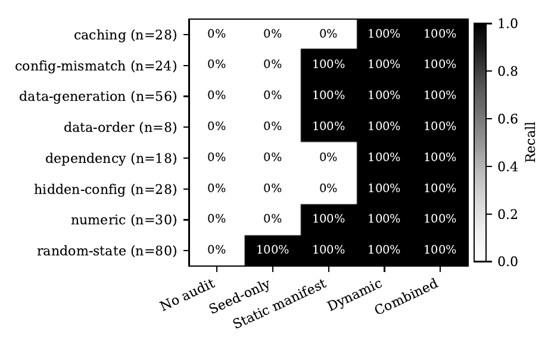

# ReproMut

[](https://doi.org/10.5281/zenodo.24048006)
[](https://github.com/Hamjeth68/repromut/actions/workflows/ci.yml)
[](https://github.com/Hamjeth68/repromut/releases)
[](LICENSE)

**A controlled mutation benchmark for dynamic reproducibility testing of small machine-learning experiments.**

> **Headline finding (exploratory):** seed checks and config-manifest checks missed **every** stale cache, hidden `.env` override and dependency drift we planted. Overall, seed checks caught 29% of the planted faults and config-manifest checks 73%; re-running the experiment caught all of them. [Read the preprint →](https://doi.org/10.5281/zenodo.24048006)



Status: `0.1.1`. This is a public exploratory release archived on Zenodo. It was not preregistered, and it is not a confirmatory study.

## Research question

When an ML experiment is shipped, which checks can tell whether re-running it will reproduce the reported result? And how much does each kind of check miss?

ReproMut deliberately breaks small, fully synthetic, CPU-only experiments in known ways. It then measures how well each auditing method detects and localises the breakage:

- **12 result-changing mutations:** unset or time-derived seeds, a changed split seed, row order, dependency default drift, a hidden `.env` override, float32 precision, a stale cache, train/eval preprocessing mismatch, generator drift (two kinds), and a loosened solver tolerance.
- **7 semantics-preserving controls:** renames, output path, notes, log level, thread count, a dependency patch bump, and config key order.
- **5 audit methods:** none, seed-only, static manifest, dynamic (repeated execution plus stage fingerprints), and static + dynamic combined.
- **An independent oracle:** it compares full arrays at a fixed tolerance, with more repeats than any auditor. The test suite checks every declared label and stage against it.

## Download

Ready-made downloads are on the [Releases page](https://github.com/Hamjeth68/repromut/releases):

- the wheel and source package;
- the preprint PDF;
- the raw results;
- SHA-256 checksums.

Releases are built automatically by `.github/workflows/release.yml` whenever a `v*` tag is pushed.

## Quick start

```bash
python -m venv .venv && source .venv/bin/activate
pip install -e ".[test]"
pytest -q                                          # 658 tests, ~30 s on 4 CPUs
repromut bench --smoke --out results/smoke         # 3 experiments, seconds
repromut bench --out results/full                  # 28 experiments, 452 cases, under 1 min
```

Audit one package by hand:

```bash
repromut list-mutations
repromut export reg-ridge-lownoise --mutation env_override --out /tmp/demo
repromut audit /tmp/demo/package --record /tmp/demo/record.json
```

Requirements: Python ≥ 3.10, numpy, scipy and scikit-learn. No GPU, network access or third-party datasets are needed.

## Development-run results (exploratory)

The full table is in [`results/dev-2026-11-08/summary.md`](results/dev-2026-11-08/summary.md). Summary of the 452 cases:

| Method | Recall (95% CI) | False-positive rate (95% CI) |
|---|---|---|
| seed-only | 29.4% (24.3–35.1) | 0.0% (0.0–2.1) |
| static manifest | 72.8% (67.2–77.7) | 6.7% (3.9–11.3) |
| dynamic | 100% (98.6–100) | 0.0% (0.0–2.1) |

The static manifest checker misses everything not written in the config: stale caches, hidden env overrides, and dependency drift. It also raises false alarms on harmless thread-count changes.

**Read this before quoting the numbers.** The dynamic auditor and the oracle both execute the package, so near-perfect dynamic recall on deterministic mutations is expected by construction. These numbers are not a confirmatory result. See [`docs/limitations.md`](docs/limitations.md).

## What v0.1 demonstrates — and what it does not

**Demonstrated (development run on 2026-11-08, Linux aarch64, Python 3.10, scikit-learn 1.7.2):**

- All 28 baseline experiments are repeatable across repeated runs at a strict numerical tolerance (`atol=rtol=1e-12`).
- All 452 mutation/experiment pairs behave as declared, according to the independent oracle.
- The detection rates in the table above, on this synthetic suite.

**Not demonstrated:**

- Performance on real research repositories.
- How complete the mutation taxonomy is.
- GPU, distributed or deep-learning workloads.
- Usability for other researchers.
- Stability across future library versions.
- Scientific correctness of any audited experiment. **Passing ReproMut does not mean an experiment is correct.**

## Preprint

A draft preprint is in [`paper/repromut-preprint.pdf`](paper/repromut-preprint.pdf), with its source in `paper/`. Rebuild the figures with `python paper/make_figures.py results/dev-2026-11-08 paper/figures`, then compile with `latexmk -pdf paper/repromut-preprint.tex`.

## Repository map

| Path | Contents |
|---|---|
| `src/repromut/runner.py` | Package format and hermetic executor |
| `src/repromut/experiments.py` | 28 baseline experiments and the seed hierarchy |
| `src/repromut/mutations.py` | Mutation catalog |
| `src/repromut/auditors.py` | Audit methods and record format |
| `src/repromut/oracle.py` | Ground-truth oracle |
| `src/repromut/benchmark.py` | Benchmark runner and report |
| `docs/` | Method, taxonomy, data card, limitations, related-work plan |
| `PREREGISTRATION.md` | Draft hypothesis to freeze before the confirmatory run |
| `INDEPENDENCE.md` | Provenance and employment-separation log |

## Licence

- **Code:** Apache-2.0 (see `LICENSE`).
- **Documentation:** CC BY 4.0.
- **Generated fixtures:** CC0.

See `INDEPENDENCE.md` for the project's provenance and separation record. That record is evidence, not a legal conclusion.

## Citation

Preprint (draft v0.1): Misree, H. (2026). *ReproMut: A Controlled Mutation Benchmark for Comparing Reproducibility Auditors on Small Machine-Learning Experiments.* Zenodo. https://doi.org/10.5281/zenodo.24048006

To cite all versions, use the concept DOI 10.5281/zenodo.24048005. Machine-readable metadata is in `CITATION.cff`.
